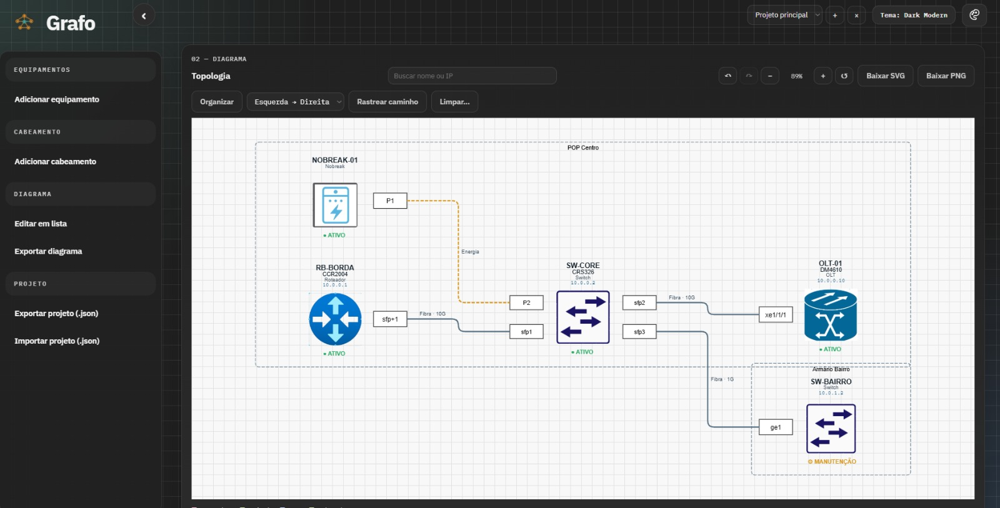

# Grafo

**G**erador **R**ápido **A**utomatizado de **F**luxos **O**rganizados: monta diagramas de topologia de rede (OLTs, switches, roteadores, nobreaks…) a partir de equipamentos e cabeamentos cadastrados no navegador.



## Recursos

- **Diagrama automático**: o layout é recalculado a cada mudança, com cabos roteados em ângulo reto e portas no lado voltado para o vizinho.
- **Edição direta**: duplo clique (ou Enter) num equipamento ou cabo abre o editor, com a opção de excluir.
- **Grupos e status**: equipamentos agrupados por rack/sala/POP e marcados como ativo, em manutenção ou offline.
- **Busca** por nome, IP ou modelo, com destaque no diagrama (Enter vai para o próximo resultado).
- **Rastrear caminho**: escolha dois equipamentos e o menor caminho de cabos entre eles é destacado.
- **Organizar** refaz o layout respeitando os grupos, na direção escolhida (esquerda→direita ou cima→baixo).
- **Capacidade livre** nos cabos (100M, 2.5G, 400G, XGS-PON…), padronizada automaticamente (`2,5 gbps` → `2.5G`).
- **Exportação em PNG e SVG** com cabeçalho (projeto, data, totais) e legenda.
- **Vários projetos**, desfazer/refazer, importação de CSV e backup em JSON.
- Botão **Carregar exemplo** na tela vazia para ver a ferramenta funcionando.

## Rodando localmente

Requer Node.js 18+.

```bash
npm install
npm start        # http://localhost:3000
npm run dev      # reinicia sozinho ao salvar o servidor-local.js
```

A porta pode ser trocada com a variável `PORT`.

## Deploy (Vercel)

O projeto já está pronto para a Vercel: o `index.html` e os `assets/` são servidos como estáticos, e `api/equipamentos.js` vira uma função serverless. O `vercel.json` redireciona as demais rotas para o `index.html`.

## Estrutura

| Caminho | Conteúdo |
|---|---|
| `index.html` | Página única da aplicação |
| `assets/js/app.js` | Toda a lógica do front-end (estado, formulários, geração do DOT, exportação SVG/PNG) |
| `assets/css/styles.css` | Estilos e temas |
| `assets/images/` | Ícones dos equipamentos |
| `assets/js/icones-embutidos.js` | Cópia dos ícones em base64 para a exportação PNG/SVG — **gerado**, veja abaixo |
| `scripts/gerar-icones-embutidos.js` | Gera o arquivo acima (`npm run icones`) |
| `data/equipamentos.json` | Catálogo de tipos de equipamento — **edite aqui** (fica fora de `api/` para não colidir com `api/equipamentos.js` na Vercel) |
| `api/equipamentos.js` | Função da Vercel que serve o catálogo |
| `docs/captura.png` | Imagem usada neste README |
| `servidor-local.js` | Servidor Express só para rodar localmente (não se chama `server.js` para a Vercel não tratar o projeto como app Express) |

## Onde ficam os dados

Os projetos são salvos no `localStorage` do navegador. Limpar os dados do site ou trocar de navegador apaga tudo, então use **Projeto → Exportar projeto (.json)** na barra lateral (ou **Ctrl+S**) para guardar uma cópia e **Importar projeto (.json)** para restaurar.

Um aviso no topo lembra de fazer backup quando o projeto aberto tem mudanças e o último backup tem 7 dias ou mais (ou quando nunca foi feito backup e a primeira mudança tem mais de 1 dia). "Depois" adia o aviso por um dia.

## Ícones dos equipamentos

Ao adicionar ou trocar uma imagem em `assets/images/`, rode:

```bash
npm run icones
```

Isso atualiza `assets/js/icones-embutidos.js`, que a exportação usa para colocar os ícones dentro do PNG/SVG. Sem ele, com o app aberto direto do disco (`file://`), o navegador bloqueia a leitura das imagens e o PNG sai sem os ícones.

## Importar CSV

Em **Editar em lista → Importar / exportar JSON e CSV → Importar CSV** (o botão **Baixar modelo CSV** ao lado gera um exemplo). Uma linha por cabo; os equipamentos são criados pelos nomes. Linha sem `destino` cadastra só o equipamento. A importação substitui o projeto aberto — o botão ↶ desfaz.

| Coluna | Também aceita | Exemplo |
|---|---|---|
| `origem` (obrigatória) | `de`, `equipamento`, `nome` | `OLT-01` |
| `destino` | `para` | `SW-CORE` |
| `porta_origem` / `porta_destino` | `saida` / `chegada` | `xe1/1/1` |
| `ip_origem` / `ip_destino` | `ip` | `10.0.0.2` |
| `modelo_origem` / `modelo_destino` | `modelo` | `DM4270` |
| `tipo_origem` / `tipo_destino` | `tipo_equipamento` | `OLT` |
| `tipo` | `enlace`, `cabo` | `Fibra` |
| `capacidade` | `potencia`, `velocidade` | `10G` |

Separador `;`, `,` ou tab; o arquivo pode estar em UTF-8 ou no formato padrão do Excel em português (Windows-1252). Nomes de coluna não diferenciam maiúsculas nem acentos.

O diagrama é desenhado com [Viz.js](https://github.com/mdaines/viz-js) (Graphviz em WebAssembly), carregado via CDN.
