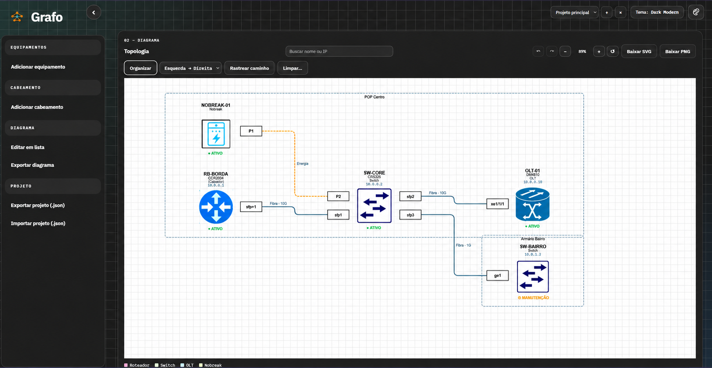

# Grafo

**G**erador **R**ápido **A**utomatizado de **F**luxos **O**rganizados — monta diagramas de topologia de rede (OLTs, switches, roteadores, ONUs, servidores, nobreaks…) direto no navegador, a partir dos equipamentos e cabos que você cadastra. Cada pessoa entra com a própria conta e os projetos ficam salvos na nuvem.

**Acesse:** https://thegrafo.vercel.app



## Sumário

- [Recursos](#recursos)
- [Como usar](#como-usar)
- [Atalhos](#atalhos)
- [Tipos de diagrama](#tipos-de-diagrama)
- [Importar e exportar](#importar-e-exportar)
- [Onde ficam os dados](#onde-ficam-os-dados)
- [Ícones dos equipamentos](#ícones-dos-equipamentos)
- [Modelos de equipamento e portas](#modelos-de-equipamento-e-portas)
- [Etiquetas com QR code](#etiquetas-com-qr-code)
- [Configuração (para quem mantém o projeto)](#configuração-para-quem-mantém-o-projeto)
  - [1. Supabase (login e banco)](#1-supabase-login-e-banco)
  - [2. Rodar localmente](#2-rodar-localmente)
  - [3. Publicar na Vercel](#3-publicar-na-vercel)
  - [Problemas comuns](#problemas-comuns)
- [Estrutura do projeto](#estrutura-do-projeto)
- [Tecnologias](#tecnologias)
- [Licença e direitos autorais](#licença-e-direitos-autorais)

## Recursos

**Conta e nuvem**
- Login com e-mail e senha, criação de conta e recuperação de senha por e-mail.
- Cada pessoa vê só os próprios projetos, salvos automaticamente na nuvem.
- Indicador no topo: **Salvo na nuvem**, **Alterações pendentes** ou erro com **Tentar novamente**.
- No primeiro login, o app oferece copiar para a conta os projetos que já estavam salvos no navegador.

**Diagrama**
- Layout automático, recalculado a cada mudança, com cabos em ângulo reto e cada porta no lado voltado para o vizinho.
- Cabos desviam uns dos outros, **não passam por cima de equipamentos** e contornam as caixas de outros grupos.
- **Grupos** (rack, sala, POP) viram caixas em volta dos equipamentos; se duas caixas se encostam, o grupo é empurrado para fora automaticamente — o grupo que você acabou de arrastar fica parado.
- **Status** por equipamento: ativo, em manutenção ou offline.
- **Capacidade** livre nos cabos, padronizada sozinha (`10 gbps` → `10G`, `2,5g` → `2.5G`, `100 Mb` → `100M`).
- Estilo do cabo: contínuo, tracejado ou pontilhado, com cor e espessura.

**Edição**
- Duplo clique (ou Enter) num equipamento ou cabo abre o editor, com opção de excluir.
- Arrastar com o mouse ou mover com as setas do teclado. Ao arrastar, **guias de alinhamento** aparecem quando a borda ou o centro do equipamento se alinha com outro, e ele "gruda" na posição (segure **Alt** para mover livre).
- **Seleção de vários equipamentos**: `Shift`/`Ctrl` + clique soma ou tira; `Shift` + arrastar numa área vazia desenha um retângulo; `Ctrl+A` seleciona tudo. Os selecionados andam juntos (mouse ou setas), e uma barra mostra **Duplicar**, **Copiar** e **Excluir**.
- **Copiar e colar** (`Ctrl+C` / `Ctrl+V`, ou `Ctrl+D` para duplicar): as cópias ganham nomes novos ("SW-CORE (cópia)"), levam junto os cabos entre elas e respeitam o limite de 35. Dá para colar em outro projeto.
- **Anotações**: caixas de texto livres no diagrama ("aguardando instalação", "cliente X"), em 5 cores. Botão **Anotação** cria no centro da tela; duplo clique edita; arrastar move. Saem no PDF, PNG, SVG e no link compartilhado.
- **Editar em lista**: todos os equipamentos e cabos numa tabela, com filtro.
- **Limpar…**: remove tudo, só os cabos, ou os equipamentos de um tipo, grupo ou status.
- Desfazer / refazer (`Ctrl+Z` / `Ctrl+Y`).

**Navegação**
- **Busca** por nome, IP ou modelo, com destaque no diagrama.
- **Rastrear caminho**: escolha dois equipamentos e o menor caminho de cabos entre eles é destacado.
- **Organizar** refaz o layout respeitando os grupos, na direção escolhida (esquerda → direita ou cima → baixo).
- **Centro (estrela)** (no mesmo seletor): o equipamento com mais ligações fica no meio; os vizinhos dele se dividem em colunas à esquerda e à direita e numa linha embaixo, e o que vem depois de cada vizinho segue para fora, em camadas (o que continua ligado entre si, como conversores que chegam no mesmo DIO, fica junto). **Automático**, o padrão, usa a estrela quando algum equipamento tem 8 ou mais vizinhos e Esquerda → Direita nos demais.
- **Grupos lado a lado** (no mesmo seletor): cada grupo mantém a própria hierarquia (quem liga em quem, como no Esquerda → Direita), mas os grupos são arrumados em linhas na proporção da folha do PDF, em vez de um embaixo do outro. Com 35 equipamentos em 4 grupos, o desenho passa de alto e estreito para quase o formato da folha, e em A4 paisagem a escala vai de ~13% para ~23%.
- **Grade por grupo** (no mesmo seletor) arruma cada grupo em linhas e colunas, com os equipamentos ligados entre si lado a lado, e distribui os grupos na proporção da folha do PDF. Com muitos equipamentos, aproveita bem melhor a página: com 35 equipamentos em A4, a escala vai de ~16% para ~32%.
- Navegação fluida, animada a cada quadro e acelerada pela placa de vídeo:
  - **roda do mouse**: zoom em torno do cursor, deslizando até o ponto (giros rápidos acumulam);
  - **touchpad**: deslizar dois dedos move o diagrama; **pinça** dá zoom;
  - **tela de toque**: um dedo move, dois dedos dão zoom;
  - botões **+ / − / ↺** com a mesma animação; arrastar a área ou um equipamento segue o ponteiro sem atraso.
  - O diagrama continua centralizado quando os painéis abrem ou fecham. Com "reduzir movimento" ligado no sistema, as animações são desligadas.

**Projetos e interface**
- Vários projetos por conta, com backup em JSON e importação de CSV.
- Até **35 equipamentos por diagrama**, com contador visível (`n/35`) e aviso ao atingir o limite.
- Exportação em **PDF** (A0 a A5, retrato ou paisagem, escala ajustável, com prévia), **PNG** e **SVG**, com cabeçalho (projeto, data, totais) e legenda.
- **Relatório de inventário** (barra lateral): planilha Excel (.xlsx) com as abas **Resumo** (totais por tipo, grupo e status), **Equipamentos** (IP, modelo, fabricante, portas livres), **Cabos** e **Portas** (cada porta livre ou em uso, ligada a quê e em qual porta do outro lado). Abre no Excel, LibreOffice e Google Planilhas.
- **Histórico de versões** (botão **Histórico**, ao lado da lista de projetos): o Grafo guarda sozinho uma versão a cada alteração (no máximo uma a cada 10 minutos), por até 90 dias. Dá para **restaurar a versão de ontem** (a restauração também pode ser desfeita), **recuperar um projeto excluído** e **guardar uma versão agora** antes de uma mudança grande. Nos projetos de equipe, todos os membros veem o histórico e quem salvou cada versão.
- Temas claros, escuros e de alto contraste; barra lateral recolhível.
- Avisos rápidos no canto da tela ao exportar, importar ou copiar.
- Respeita a opção "reduzir movimento" do sistema.
- Botão **Carregar exemplo** na tela vazia para ver a ferramenta funcionando.

## Como usar

1. Abra https://thegrafo.vercel.app, clique em **Criar conta** e confirme pelo link enviado ao seu e-mail (veja também o spam).
2. **Adicionar equipamento** (barra lateral): nome, tipo, modelo, IP, grupo, status e ícone.
3. **Adicionar cabeamento**: origem, destino, portas, tipo de enlace, capacidade, cor e estilo.
4. O diagrama é redesenhado sozinho. Arraste os equipamentos para ajustar, ou use **Organizar**.
5. **Exportar** (acima do diagrama) gera PDF, PNG ou SVG; **Exportar projeto (.json)**, no mesmo menu, guarda um backup.

Esqueceu a senha? Na tela de login, clique em **Esqueci minha senha** e siga o link do e-mail.

## Atalhos

| Onde | Tecla | Ação |
|---|---|---|
| Qualquer lugar | `Ctrl+S` | Exportar o projeto (.json) |
| Diagrama | `Ctrl+Z` / `Ctrl+Y` (ou `Ctrl+Shift+Z`) | Desfazer / refazer |
| Diagrama | `Ctrl+A` | Selecionar todos os equipamentos |
| Diagrama | `Shift`/`Ctrl` + clique · `Shift` + arrastar no vazio | Somar à seleção · retângulo de seleção |
| Seleção | `Ctrl+C` / `Ctrl+V` / `Ctrl+D` | Copiar / colar / duplicar |
| Seleção | `Delete` | Excluir os selecionados (e os cabos deles) |
| Seleção | `Esc` | Limpar a seleção |
| Arrastando | `Alt` | Mover livre, sem grudar nas guias de alinhamento |
| Equipamento selecionado | `Enter` / `F2` | Abrir o editor |
| Equipamento selecionado | `←` `↑` `→` `↓` | Mover a seleção 10 px (`Shift` + seta: 50 px) |
| Anotação | duplo clique / `Enter` · `Ctrl+Enter` na janela | Editar · salvar |
| Cabo selecionado | `Enter` / `F2` | Abrir o editor |
| Busca | `Enter` / `Shift+Enter` | Próximo / anterior resultado |
| Busca | `Esc` | Limpar a busca |
| Janelas | `Esc` | Fechar |

## Tipos de diagrama

Ao criar um projeto (botão **+**), escolha o tipo de diagrama. Dá para trocar depois no seletor que fica no lugar do título, na barra do diagrama. O tipo fica salvo no projeto (`"modo"` no JSON: `topologia`, `redes` ou `monitoramento`); projetos sem ele são Topologia.

| Tipo | O equipamento mostra | Legenda | Destaques |
|---|---|---|---|
| **Topologia** | nome, modelo, tipo, IP, portas e status | por tipo | — |
| **Diagrama de redes** | nome, **IP**, **VLAN / rede**, tipo | por tipo | campo **VLAN / rede** nos formulários |
| **Monitoramento** | nome, tipo, IP e uma faixa colorida com o status | contagem por status ("3 ativos · 1 offline") | cabo ligado a equipamento offline fica vermelho e tracejado |

Cada tipo também põe primeiro, na lista de **Tipo**, os equipamentos que fazem sentido para ele (Monitoramento: câmera, NVR, controle de acesso…; Redes: RB/CCR, switch, OLT…). O PDF/PNG/SVG exportado mostra o tipo no cabeçalho, e o nome do arquivo leva `-rede` ou `-monitoramento`. O status é o que você marca em cada equipamento (ativo, manutenção, offline); o Grafo não testa os IPs sozinho.

## Mapa Regional

Monta a rede por cima dos municípios (**Editar diagrama → Mapa de regiões**).

1. **Municípios (vetor):** importe GeoJSON, TopoJSON ou SVG com polígonos. Para o Brasil, use a malha municipal oficial do IBGE (Malhas Territoriais, municípios por UF), abra no [mapshaper.org](https://mapshaper.org), aplique *Simplify* e exporte. Coordenadas em graus são projetadas mantendo a proporção (norte para cima); coordenadas já projetadas (UTM etc.) só são escaladas. Shapefile e KML precisam passar pelo mapshaper antes.
2. **Escolha os municípios:** busque por nome ou código IBGE, mostre/oculte, dê uma cor a cada um ou use *Só com equipamentos*.
3. **Equipamentos:** escolha o **Município** no cadastro ou na edição; o equipamento vai para um ponto dentro do território (não o centro da caixa). Vários no mesmo município ficam empilhados. **Fixar posição** impede o Organizar de mexer. Com mapa, o Organizar só devolve cada equipamento para dentro do seu município.
4. **Cabos:** os mesmos do diagrama, com o traçado esquemático (horizontal/vertical) e dobras manuais. A **distância** é a cadastrada no cabo (aparece no selo, ex.: `100G · 20 km`); o Grafo nunca calcula quilômetros pelo desenho.
5. **Estilos:** *Referência* (verde, limites e cabos pretos, sombra) ou *Grafo* (cores suaves e cabos coloridos). Cor de preenchimento, limites, sombra e nomes das cidades são ajustáveis.
6. **Imagem de fundo:** PNG, JPG ou SVG (o SVG é limpo de scripts). Tem opacidade, rotação, mostrar/ocultar e bloquear. É só um desenho: não tem municípios nem coordenadas.

O mapa fica salvo no projeto (inclusive a imagem) e sai no PDF, PNG e SVG. Camadas: *Mapa* e *Nome das cidades*. Modelo pronto: **Rota 100G no mapa** (exemplo do PDF de Ibirubá a Boqueirão do Leão, com pendências de revisão na nota).

## Bayface de Racks

Disposição **física** dos equipamentos nos racks — independente do diagrama lógico (IP, VLAN e rotas continuam no diagrama). Crie um projeto do tipo **Bayface de Racks** (ou troque o tipo de um projeto existente no seletor da barra do diagrama: o diagrama lógico fica guardado e volta quando você troca de novo).

- **Racks**: vários por projeto, agrupados por local (sala, POP, datacenter). Nome, patrimônio, local, fabricante, modelo, altura de 1U a 60U (12, 24, 36, 42, 44, 45, 48 ou outra), largura, profundidade, status (planejado, em montagem, instalado, desativado) e observações. Duplicar, excluir (com confirmação) e buscar racks e equipamentos.
- **Editor**: vista frontal e traseira, U1 embaixo (dá para inverter na tela sem mudar a numeração), zoom, U livres tracejadas, ocupação (“16/44U · 28 livres”). Arraste da **Biblioteca** para o rack, clique numa U livre e escolha a categoria, ou clique numa peça da biblioteca para instalar na primeira posição livre. Arraste um equipamento (ou use ↑/↓) para mover; Delete remove.
- **Categorias**: servidor, switch, roteador, OLT, DIO, patch panel, organizador, bandeja fixa e deslizante, PDU, nobreak, DWDM, telecom, painel cego e personalizado — cada uma com sigla no desenho (não depende só da cor).
- **Equipamento**: nome, categoria, fabricante, modelo, U inicial, altura, face (profundidade total, só frente ou só traseira), estado (instalado, planejado, a remover), cor, patrimônio, portas (quantidade, tipo e prefixo, ex.: `ge1/`), largura, profundidade, observações e, opcionalmente, o equipamento do diagrama lógico que ele representa.
- **Regras físicas** (no editor e na validação do projeto, `assets/js/comum/esquema.js`): nada passa do topo nem abaixo de U1; duas peças não dividem a mesma U, exceto uma **só frente** com uma **só traseira**; peças de várias U ocupam todas elas; posição inválida mostra o motivo e não grava.
- **Cabos físicos** (rede, fibra, cordão óptico, energia, outro): porta de origem e de destino (inclusive em outro rack), identificação, comprimento, cor e observações. Uma porta tem no máximo um cabo. No desenho, os do mesmo rack voltam pela lateral; os que vão para outro rack terminam numa etiqueta. Filtro por tipo ou ocultos.
- **Exportar**: PNG, SVG, PDF do rack ou **PDF de todos** (um por página), com projeto, rack, local, ocupação, inventário e U livres; **Relatório** (.xlsx) com racks, equipamentos, situação de cada U e cabos.

Os racks ficam no próprio projeto (`racks` e `cabosRack` no JSON): salvam no navegador e na nuvem, entram no desfazer, no histórico de versões, nos projetos de equipe e no backup. Limites: 60 racks por projeto, 120 equipamentos por rack, 3000 cabos físicos. O link “Compartilhar” (só leitura) mostra o diagrama lógico.

## Importar e exportar

### Projeto em JSON

**Projeto → Exportar projeto (.json)** e **Importar projeto (.json)** na barra lateral. A importação cria um projeto novo. Também dá para colar o JSON em **Projeto → JSON e CSV → Aplicar JSON** (isso substitui o projeto aberto; o ↶ desfaz).

Formato:

```json
{
  "projeto": "Meu POP",
  "equipamentos": [
    { "id": "olt1", "nome": "OLT-01", "tipo": "OLT", "modelo": "DM4610", "ip": "10.0.0.10", "grupo": "POP Centro", "status": "ativo" },
    { "id": "sw1",  "nome": "SW-CORE", "tipo": "Switch", "ip": "10.0.0.2", "grupo": "POP Centro", "status": "manutencao" }
  ],
  "conexoes": [
    { "de": "sw1", "para": "olt1", "tipo": "Fibra", "saida": "sfp2", "chegada": "xe1/1/1", "potencia": "10G", "cor": "#5A7284", "grossura": 2, "estilo": "solid" }
  ]
}
```

| Campo | Regras |
|---|---|
| `id`, `nome` | Obrigatórios; `id` não pode repetir |
| `ip` | IPv4 ou IPv6, com máscara opcional (`10.0.0.0/24`) |
| `status` | `ativo`, `manutencao` ou `offline` (aceita "Manutenção", "OFFLINE"…) |
| `estilo` | `solid`, `dashed` ou `dotted` (aceita "contínuo", "tracejado", "pontilhado") |
| `cor` | Formato `#1A2B3C` |
| `corIcone` (opcional) | Tom do ícone do equipamento, formato `#1A2B3C` (ex.: switch de core verde). Vazio ou ausente: cores originais. No editor do equipamento: **Cor do ícone** (marque **Original** para voltar) |
| `grossura` | De 1 a 10 |
| `de` / `para` | Precisam ser `id`s de equipamentos existentes e diferentes entre si |
| `anotacoes` (opcional) | Lista de `{ "id", "texto", "x", "y", "cor" }`: até 50, texto de até 500 caracteres, cor `#FFF3B0` (amarelo), `#D6ECFF`, `#DDF5D8`, `#FFDDE4` ou `#ECEFF3` |

Se algo estiver errado, **nada é alterado** e o app lista cada problema com o item e o campo.

**Conexões para equipamentos que não existem** (ex.: um cabo de `EQ-100` para `EQ-999`, sem `EQ-999` no arquivo) **são ignoradas** e aparecem num aviso; o restante do arquivo é importado normalmente. O mesmo vale para cabos com origem e destino iguais. Equipamentos sem nenhuma conexão são permitidos.

Limites: **35 equipamentos por diagrama**, 2000 cabos e 100 projetos. Um arquivo com mais de 35 equipamentos é recusado.

### NetBox e status online (agente)

Na barra lateral, **Integração → NetBox e status online**:

1. **Carregar POPs** lista os sites do NetBox; escolha o POP e clique em **Gerar diagrama do POP**. O Grafo cria um projeto novo com os equipamentos do site e os cabos documentados (porta de saída e de chegada, fibra ou cabo, cor; cabo *planned* fica tracejado). Cabos que saem do POP ou terminam em patch panel/circuito ficam de fora. Status do NetBox: *active* → ativo; *planned/staged/inventory* → manutenção; *offline/failed* → offline. Até 35 equipamentos por diagrama.
2. **Verificar online** dá ping nos IPs do projeto aberto e marca **ativo** ou **offline** (equipamento em manutenção não muda). **Verificar a cada 60 s** repete sozinho enquanto o editor estiver aberto. Com o agente rodando, **ao colocar ou trocar o IP de um equipamento** (formulário, editor, CSV ou JSON) o Grafo dá ping nele na hora e mostra o resultado num aviso.

O site na Vercel não alcança a rede interna, então quem fala com o NetBox e dá o ping é o **agente**, um programa sem dependências que roda num computador dentro da rede:

```bash
cp agente/.env.example agente/.env   # preencha NETBOX_URL e NETBOX_TOKEN (token só leitura)
npm run agente                       # http://localhost:8787
```

**Sem NetBox para testar?** `npm run netbox-falso` sobe uma API falsa em `http://localhost:8000` (token `teste123`) com dois POPs de exemplo; no `agente/.env` use `NETBOX_URL=http://localhost:8000` e `NETBOX_TOKEN=teste123`. IPs `127.0.0.x` respondem ao ping (online) e `10.255.x.x` não (offline).

O editor chama `http://localhost:8787` (o CSP libera só `localhost`/`127.0.0.1` em http), então o agente deve rodar **no mesmo computador** em que o Grafo está aberto. `ORIGENS` limita quais sites podem usá-lo e `AGENTE_CHAVE` (opcional) exige uma senha.

### CSV

Em **Projeto → JSON e CSV → Importar CSV** (o botão **Modelo CSV** gera um exemplo). Uma linha por cabo; os equipamentos são criados pelos nomes. Linha sem `destino` cadastra só o equipamento. A importação substitui o projeto aberto (se ele já tiver conteúdo, o Grafo pergunta antes) — o ↶ desfaz.

| Coluna | Também aceita | Exemplo |
|---|---|---|
| `origem` (obrigatória) | `de`, `equipamento`, `nome` | `OLT-01` |
| `destino` | `para` | `SW-CORE` |
| `porta_origem` / `porta_destino` | `saida` / `chegada` | `xe1/1/1` |
| `ip_origem` / `ip_destino` | `ip` | `10.0.0.2` |
| `vlan_origem` / `vlan_destino` | `vlan`, `rede` | `VLAN 10 · 10.0.0.0/24` |
| `modelo_origem` / `modelo_destino` | `modelo` | `DM4270` |
| `tipo_origem` / `tipo_destino` | `tipo_equipamento` | `OLT` |
| `tipo` | `enlace`, `cabo` | `Fibra` |
| `capacidade` | `potencia`, `velocidade` | `10G` |

Separador `;`, `,` ou tab. O arquivo pode estar em UTF-8 ou no formato padrão do Excel em português (Windows-1252). Nomes de coluna não diferenciam maiúsculas nem acentos.

### Imagem do diagrama

**Imagem PNG** e **Vetor SVG**, no menu **Exportar** acima do diagrama. O arquivo sai com cabeçalho (projeto, data, totais) e legenda.

### PDF

O botão **PDF…** (acima do diagrama) abre a barra lateral direita **Página e PDF**:

| Opção | O que faz |
|---|---|
| Área de desenho (largura × altura) | Limite até onde os equipamentos podem ser arrastados (1000 a 20000 px) |
| Formato | A0, A1, A2, A3, A4 ou A5 |
| Orientação | Retrato ou paisagem |
| Escala | **Ajustar à página** (tudo numa folha) ou 25% a 200% — com escala fixa, o desenho é dividido em várias páginas, sem cortar nada |
| Margem | 0 a 40 mm |
| Cabeçalho e legenda | Inclui ou não o título, a data, os totais e a legenda |

A **prévia** mostra as folhas como vão sair (a linha tracejada é a margem) e avisa quando o texto vai ficar pequeno demais para o formato escolhido. **Baixar PDF** gera o arquivo em vetor: o texto fica nítido em qualquer zoom e pode ser selecionado e pesquisado. Textos com caracteres que a fonte do PDF não tem (emoji, setas, "●") entram como pequenas imagens no mesmo lugar. Se o gerador vetorial não carregar, o PDF sai como imagem de ~200 DPI.

## Onde ficam os dados

Os projetos ficam na sua conta, no Supabase, e são salvos automaticamente poucos segundos depois de cada mudança. Enquanto você está logado, o navegador mantém uma cópia local separada por usuário; ao clicar em **Sair**, essa cópia é apagada e os projetos continuam na conta.

- Use **Exportar projeto (.json)** (ou `Ctrl+S`) para guardar também um backup fora da nuvem. Um aviso no topo lembra de fazer isso quando o último backup tem 7 dias ou mais.
- **Equipe** (ao lado da lista de projetos) transforma o projeto aberto em **projeto de equipe**: o dono gera um link de convite, e quem entra por ele (com a própria conta, ou criando uma) passa a editar o projeto. As alterações de cada um aparecem para os outros em segundos; se duas pessoas editarem ao mesmo tempo, vale o aviso de conflito (ninguém sobrescreve o outro sem aviso). Na lista, projetos de equipe aparecem com 👥. O dono vê os membros, remove pessoas, troca ou desativa o link e exclui o projeto para todos (×); os membros podem sair.
- **Compartilhar** (barra do diagrama) cria um link só para visualizar o projeto aberto: quem abre vê o desenho (com zoom e download em SVG), sem login, sem poder editar e sem acesso à conta. O link se atualiza sozinho poucos segundos depois de cada alteração. **Desativar link** faz o endereço parar de funcionar na hora, e excluir o projeto também apaga o link.
- **Baixar todos os projetos** (barra lateral ou botão **Conta**) gera um arquivo só com todos os projetos. **Importar projeto** aceita esse arquivo e traz todos de volta; se algum projeto tiver erro, nada é importado.
- Em **Conta → Excluir conta**, a pessoa apaga a própria conta e todos os projetos, sem volta. Para confirmar, é preciso digitar o e-mail da conta.
- Se a mesma conta salvar em outra aba ou computador, o Grafo avisa ("Projeto alterado em outro lugar") em vez de sobrescrever: dá para baixar o projeto aberto, manter a versão desta aba ou carregar a mais recente. O aviso também aparece ao voltar para uma aba que ficou desatualizada.
- **Sem internet**: depois de entrar uma vez com internet, o Grafo abre no mesmo aparelho mesmo sem conexão (útil em sala de equipamentos sem sinal), com os projetos daquele aparelho. Dá para ver, editar e exportar PDF/PNG/SVG; o topo mostra "Sem internet: as alterações ficam neste aparelho". Quando a conexão volta, a página recarrega e envia o que foi feito — se alguém tiver salvo o mesmo projeto nesse meio-tempo, aparece o aviso de conflito em vez de uma versão apagar a outra. Compartilhar, Equipe e Histórico precisam de internet. **Sair** fica bloqueado enquanto houver alteração por enviar (sair apaga a cópia do aparelho). O site também pode ser **instalado** como aplicativo (no celular: menu do navegador → "Adicionar à tela inicial"). Quem faz isso é o `sw.js` (service worker), junto com `manifest.webmanifest`.

## Ícones dos equipamentos

O ícone é escolhido pelo tipo ou nome do equipamento, ou manualmente no editor.

| Tipo | Arquivo | Reconhece |
|---|---|---|
| OLT | `OLT.png` | "olt" |
| Switch | `SWITCH.png` | "switch" |
| Roteador / MikroTik | `MIKROTIK.png` | "mikrotik", "roteador", "rb/" |
| ONU / ONT | `ONU.svg` | "onu", "ont" |
| Servidor | `SERVIDOR.svg` | "servidor", "server" |
| Nobreak / UPS | `NOBREAK.png` | "nobreak" |
| Retificador / RPS | `RETIFICADOR.png` | "retificador", "rps" |
| Ar-condicionado | `AR.png` | "ar", "hvac", "climatiz…" |
| VOLT | `VOLT.png` | "volt" |
| Câmera | `CAMERA.png` | "câmera", "camera" |

Além desses, o quadro de símbolos tem um tipo e um ícone para: Conversor de fibra, Concentrador Hotspot, CX, Decoder, DIO, AP WiFi, POE, UniFi, NVR, DWDM, MUX, DEMUX, Bateria, Switch POE, Conversor de mídia, Controle de acesso, Aligera, Dream Machine e Nuvem VPLS (arquivos com o mesmo nome em `assets/images/equipamentos/`, lista em `SIMBOLOS` de `src/app/00-catalogo.js`). O tipo é reconhecido por palavra inteira, e o nome mais específico ganha: "Switch POE 24p" usa o ícone de Switch POE, e "Rádio" não vira DIO.

Também dá para usar um emoji ou enviar uma imagem própria pelo campo **Imagem** (é reduzida para 256 px).

A lista de tipos sugeridos vem de `data/equipamentos.json` — **edite ali** para adicionar tipos. Ao adicionar ou trocar uma imagem em `assets/images/equipamentos/`, rode `npm run icones` para atualizar `assets/js/editor/icones-embutidos.js`, que a exportação usa para colocar os ícones dentro do PNG/SVG.

## Modelos de equipamento e portas

O campo **Modelo** sugere modelos conhecidos (MikroTik CCR/CRS/RB, Cisco Catalyst 2960X, Huawei S5720, Datacom DM4610 e modelos genéricos de OLT, ONU, switch, servidor, nobreak, retificador e câmera). A lista **segue o Tipo** do equipamento: com "Switch" aparecem só os switches, com "OLT" só as OLTs, com o nome de um fabricante ("MikroTik") todos os modelos dele; com o Tipo vazio, todos. Escolher um modelo com o **Tipo** vazio preenche o tipo.

O modelo pode ser escrito completo ou só o começo, quando só um modelo começa assim: `CRS326` e `DM4610` são reconhecidos.

Com o modelo preenchido, os campos **Porta origem** e **Porta destino** dos cabos (barra lateral, formulário rápido, editor e **Editar em lista**) viram uma lista com as portas daquele equipamento:

- portas **livres** primeiro; as **em uso** no fim, com o nome do equipamento do outro lado;
- o campo mostra quantas estão livres (ex.: "25 de 26 portas livres") e sugere a primeira livre;
- digitar outra porta continua valendo — a lista é só sugestão;
- salvar um cabo numa porta que outro cabo já usa **não é bloqueado**, mas aparece um aviso.

O modelo é reconhecido pelo nome exato, com o fabricante na frente (`MikroTik CRS326-24G-2S+`) ou com texto a mais (`CRS326-24G-2S+ rack 2`).

### Adicionar ou corrigir modelos

Os modelos ficam em `data/equipamentos.json`, na lista `"modelos"`:

```json
{ "nome": "CRS326-24G-2S+", "fabricante": "MikroTik", "tipo": "Switch", "portas": ["ether1-24", "sfp-sfpplus1-2"] }
```

Em `portas`, uma faixa termina em `início-fim` e vira uma porta para cada número: `ether1-24` → `ether1` … `ether24`; `gpon1/1/1-8` → `gpon1/1/1` … `gpon1/1/8`. Sem faixa, o nome vale como está (`pon`, `combo1`). Os nomes das portas seguem a nomenclatura mais comum de cada fabricante; confira com o seu equipamento e ajuste se precisar. O teste `tests/unidade/modelos.test.js` confere se o arquivo continua válido.

## Etiquetas com QR code

**Etiquetas com QR code** (barra lateral) gera um PDF para imprimir em folha A4 de etiquetas adesivas, em três tamanhos: 63,5 × 38,1 mm (21 por folha), 99,1 × 38,1 mm (14) e 38,1 × 21,2 mm (65). Imprima em **tamanho real (100%)**, sem "ajustar à página", para cair certo nas etiquetas.

- **Equipamentos**: QR code, nome, tipo/modelo, IP e grupo. Ler o QR code com a câmera do celular abre o Grafo direto na janela daquele equipamento (é preciso entrar na conta que tem o projeto; em projetos de equipe, qualquer membro).
- **Cabos**: duas etiquetas por cabo, uma para cada ponta, com o equipamento e a porta daquela ponta primeiro e, embaixo, para onde o cabo vai.

O QR code leva a `/?abrir=<id do equipamento>&projeto=<nome>` (ou `&equipe=<id>` em projeto de equipe). Renomear o projeto pessoal invalida as etiquetas impressas dele; as de equipe continuam valendo. O gerador de QR code é o `qrcode-generator` (MIT), carregado do jsDelivr com versão fixa e integrity.

## Configuração (para quem mantém o projeto)

O login usa **Supabase Auth** (e-mail e senha). Os projetos ficam na tabela `grafo_user_data`, protegida por Row Level Security: cada pessoa só lê e grava a própria linha. O navegador recebe a URL e a chave pública do Supabase pela rota `/api/auth-config`; sem elas, o app mostra um erro de configuração e mantém o editor fechado.

### 1. Supabase (login e banco)

1. Crie um projeto em https://supabase.com/dashboard (região sugerida: São Paulo).
2. **SQL Editor → New query**: cole o conteúdo de [`supabase/schema.sql`](supabase/schema.sql) e clique em **Run**. Deve aparecer "Success. No rows returned".
   - Projeto criado antes de 28/09/2026: rode também, uma vez cada, os arquivos de [`supabase/migracoes/`](supabase/migracoes/):
     - `2026-09-28-excluir-conta.sql`: sem ele, **Excluir conta** avisa que a exclusão ainda não está ativada;
     - `2026-09-28-compartilhar.sql`: sem ele, o botão **Compartilhar** não aparece.
     - `2026-09-29-equipes.sql`: sem ele, o botão **Equipe** não aparece (o resto funciona normalmente).
     - `2026-09-29-historico.sql` (depois do de equipes): sem ele, a janela **Histórico** explica que o histórico ainda não está ativado. As versões começam a ser guardadas a partir da instalação.
     - `2026-09-30-erros.sql`: registro de erros. Quando algo quebra no navegador de alguém logado, `assets/js/comum/erros.js` grava a mensagem em `grafo_erros` (no máximo 30 por pessoa por hora; apagados após 90 dias). Veja em **Table Editor → grafo_erros** ou, agrupados, com `select * from grafo_erros_resumo;` no SQL Editor. Sem ele, os erros simplesmente não são guardados.
3. **Authentication → Sign In / Providers**: deixe **Email** ligado. A opção **Confirm email** exige confirmar o e-mail antes do primeiro login — pode desligar para testes, mas mantenha ligada em produção.
4. **Authentication → URL Configuration**:
   - **Site URL**: `https://thegrafo.vercel.app`
   - **Redirect URLs**: adicione `https://thegrafo.vercel.app` e `http://localhost:3000` (e o seu domínio próprio, se tiver). Sem isso, os links de confirmação e de recuperação de senha não voltam para o app.
5. Anote as duas informações que o app usa:
   - **Project URL** — em **Project Settings → Data API**. Ex.: `https://abcdxyz.supabase.co` (**sem** `/rest/v1/` no final).
   - **Publishable key** — em **Project Settings → API Keys** (começa com `sb_publishable_`; em projetos antigos, a **anon public**).

> **Nunca** use a chave `secret` ou `service_role` no `.env`, na Vercel ou no front-end. A publishable é feita para ficar pública; a proteção dos dados vem das regras da tabela.

### 2. Rodar localmente

Requer **Node.js 18+**.

```bash
npm install
copy .env.example .env    # Windows — no Mac/Linux: cp .env.example .env
```

Abra o `.env` e preencha:

```
SUPABASE_URL=https://abcdxyz.supabase.co
SUPABASE_PUBLISHABLE_KEY=sb_publishable_xxxxxxxxxxxx
```

Depois:

```bash
npm start        # http://localhost:3000
```

O `scripts/servidor-local.js` lê o `.env` sozinho ao iniciar — se mudar o arquivo, pare o servidor (`Ctrl+C`) e rode `npm start` de novo. O `.env` não vai para o Git nem para a Vercel.

| Script | O que faz |
|---|---|
| `npm start` | Sobe o servidor local (`scripts/servidor-local.js`) |
| `npm run dev` | Igual ao `start`, reiniciando ao salvar o `scripts/servidor-local.js` |
| `npm run icones` | Gera `assets/js/editor/icones-embutidos.js` |
| `npm test` | Roda os testes da pasta `tests/unidade/` (requer Node.js 22+) |
| `npm run test:navegador` | Abre o site num navegador de verdade e testa página inicial, editor, PDF, celular e tutorial (`tests/navegador/`) |
| `npm run montar` | Monta `assets/js/editor/app.js` a partir das partes em `src/app/` |

**Para mudar o editor, edite os arquivos de `src/app/`**, não o `assets/js/editor/app.js`, e depois rode `npm run montar`. As partes são fatias, em ordem, de um único bloco de código com estado compartilhado (por isso uma parte sozinha não é um arquivo JavaScript completo). O `npm test` avisa se o `app.js` ficou desatualizado.

Os testes também rodam sozinhos no GitHub a cada envio (`.github/workflows/testes.yml`) e na Vercel antes de publicar (`buildCommand` no `vercel.json`): se algum falhar, o deploy é cancelado e o site continua na versão anterior.

Os testes de navegador rodam só no GitHub (job `navegador`), num Chromium com o Supabase simulado. Para rodar no computador: `npm install`, depois `npx playwright install chromium` (ou deixe sem: eles usam o Edge ou o Chrome instalados) e `npm run test:navegador`.

A porta pode ser trocada com a variável `PORT`. Depois de atualizar os arquivos, recarregue a página com **Ctrl+F5**.

### 3. Publicar na Vercel

O projeto `thegrafo` na Vercel está ligado a este repositório: **cada envio para o branch `main` publica o site automaticamente**. O `index.html` e os `assets/` são estáticos; `api/equipamentos.js` e `api/auth-config.js` viram funções serverless; o `vercel.json` redireciona as demais rotas para o `index.html`.

Variáveis de ambiente (configurar uma vez):

1. No projeto da Vercel, abra **Settings → Environments → Production**.
2. Em **Environment Variables**, adicione:

   | Key | Value |
   |---|---|
   | `SUPABASE_URL` | Project URL do Supabase |
   | `SUPABASE_PUBLISHABLE_KEY` | Publishable key do Supabase |

   Repita em **Preview** se usar deploys de outros branches.
3. As variáveis só valem para deploys novos: em **Deployments**, no deploy mais recente, clique em **⋯ → Redeploy**.

Para conferir, abra `https://thegrafo.vercel.app/api/auth-config`: deve mostrar a URL e a chave. Um erro 503 significa que as variáveis não estão configuradas (ou faltou o redeploy).

Também é possível publicar direto do computador com a Vercel CLI: `npx vercel deploy --prod`.

**Segurança.** O `vercel.json` envia cabeçalhos de segurança em todas as páginas (o `servidor-local.js` envia os mesmos): um CSP que só aceita scripts do próprio site e do jsDelivr, bloqueia scripts embutidos no HTML e impede que o Grafo seja aberto dentro de outro site; além de `nosniff`, `Referrer-Policy`, `Permissions-Policy` e HSTS. Por isso não há `<script>` embutido nas páginas: o código fica em arquivos (`assets/js/conta/sessao.js`, `assets/js/paginas/ver.js`). As bibliotecas do jsDelivr têm versão fixa e `integrity` (SRI): o navegador recusa o arquivo se o CDN entregar outro conteúdo. Ao atualizar uma delas, recalcule o hash (`sha384`). O teste `tests/unidade/seguranca.test.js` confere tudo isso.

### Problemas comuns

| Mensagem ou sintoma | Causa e solução |
|---|---|
| "Configure SUPABASE_URL e SUPABASE_PUBLISHABLE_KEY no servidor" | Faltam as variáveis: no `.env` (local) ou na Vercel (site). Na Vercel, faça **Redeploy** depois de criá-las |
| "E-mail ou senha incorretos" | Confira a senha, ou crie a conta primeiro |
| "Confirme seu e-mail antes de entrar" | Clique no link do e-mail de confirmação (veja o spam) |
| O link do e-mail abre `localhost` ou dá erro | Ajuste **Site URL** e **Redirect URLs** no Supabase (passo 1.4) |
| "Não foi possível carregar os projetos" | A tabela não existe ou a URL está errada: rode o `schema.sql` e confira se a URL não termina em `/rest/v1/` |
| "Muitas tentativas seguidas" | Limite do Supabase; aguarde um minuto |
| `npm.ps1 não pode ser carregado` (PowerShell) | Use `npm.cmd start` no lugar de `npm start` |
| `EADDRINUSE :::3000` | Já há um servidor rodando na porta 3000; feche o outro terminal |
| `Cannot find module 'express'` | Rode `npm install` |

## Estrutura do projeto

```
index.html                  o app: login + editor
ver.html                    página do link compartilhado (/ver?t=...)
manifest.webmanifest, sw.js instalar como aplicativo e funcionar sem internet (ficam na raiz por causa do escopo)
vercel.json, .vercelignore  publicação na Vercel (cabeçalhos de segurança, rotas)

assets/                     tudo o que o navegador baixa
  css/styles.css            estilos, temas e animações
  images/
    app/                    logo, favicon, ícones do aplicativo e logos dos temas
    equipamentos/           ícones dos equipamentos (quadro de símbolos)
    racks/                  fotos dos equipamentos para o Bayface de Racks
  js/
    comum/                  esquema.js (validação), erros.js (registro de erros), interface.js (menus, dicas)
    conta/                  auth.js (login, cadastro, sincronização), sessao.js (abre o editor rápido)
    editor/                 app.js e icones-embutidos.js — GERADOS, não edite à mão
    paginas/                ver.js (página do link compartilhado)
    recursos/               módulos do editor: admin, biblioteca, comandos, compartilhar, equipe,
                            etiquetas, historico, instalar, integracao, leitor, planilha,
                            primeiros-passos, racks
  vendor/                   Zod (validação), servido localmente

src/app/                    partes do editor, de 00-catalogo.js a 15-pagina-e-pdf.js — É AQUI QUE SE EDITA
                            (npm run montar junta tudo em assets/js/editor/app.js, na ordem dos números)
data/equipamentos.json      catálogo de tipos e modelos de equipamento (por fabricante)
api/                        funções da Vercel: auth-config, equipamentos e ler-imagem (IA)
agente/                     agente local do NetBox/ping e um NetBox de teste (.env.example)
supabase/                   schema.sql e migracoes/ (veja migracoes/LEIAME.md para a ordem)
scripts/                    montar-app.js, gerar-icones-embutidos.js, servidor-local.js
tests/
  unidade/                  testes rápidos (npm test) e simulador.js (navegador simulado)
  navegador/                testes num navegador de verdade (npm run test:navegador) e ajuda.js
docs/imagens/               imagens deste README
.github/workflows/          testes automáticos no GitHub
```

| Arquivo | Conteúdo |
|---|---|
| `assets/js/editor/app.js` | Editor: estado, formulários, geração do DOT, roteamento dos cabos, exportação. **Gerado** por `npm run montar` a partir de `src/app/` |
| `assets/js/editor/icones-embutidos.js` | Ícones em base64 para a exportação. **Gerado** por `npm run icones` a partir de `assets/images/equipamentos/` |
| `assets/js/conta/auth.js` | Login, cadastro, recuperação de senha, uso sem login e sincronização com o Supabase |
| `assets/js/recursos/equipe.js` | Projetos de equipe: grava cada um na própria linha, recebe as alterações dos colegas em tempo real e controla a janela **Equipe** |
| `assets/js/recursos/compartilhar.js` | Botão **Compartilhar**: cria, atualiza e desativa os links só para visualizar |
| `assets/js/recursos/historico.js` | Janela **Histórico**: versões guardadas pelo banco, restaurar e recuperar projeto excluído |
| `assets/js/recursos/planilha.js` | **Relatório de inventário**: monta o .xlsx no navegador (ZIP + XML, sem biblioteca externa) |
| `assets/js/recursos/etiquetas.js` | PDF de etiquetas com QR code e abertura do equipamento pelo endereço do QR code |
| `assets/js/comum/esquema.js` | Validação dos dados (formulários, JSON, CSV e o que está salvo) |
| `assets/js/comum/erros.js` | Envia os erros do navegador para a tabela `grafo_erros` do Supabase |
| `scripts/servidor-local.js` | Servidor Express para rodar localmente; lê o `.env` da raiz |
| `sw.js` | Se mudar a forma de guardar, troque o nome `grafo-offline-v3` (o antigo é apagado) |

Projetos salvos com os caminhos antigos dos ícones (`assets/images/OLT.jpeg`, `assets/images/OLT.png`) continuam abrindo: o editor troca pelo caminho atual.
> O catálogo fica em `data/`, fora de `api/`, porque na Vercel `api/equipamentos.js` e `api/equipamentos.json` colidiriam na mesma rota. O servidor local se chama `servidor-local.js` (e não `server.js`) para a Vercel não tratar o projeto como app Express.

## Tecnologias

- [Viz.js](https://github.com/mdaines/viz-js) — Graphviz em WebAssembly, carregado via CDN, desenha o diagrama.
- [Supabase](https://supabase.com) — login e banco de dados dos projetos.
- [Zod](https://zod.dev) — validação dos dados.
- [Express](https://expressjs.com) — servidor local.
- HTML, CSS e JavaScript puros, sem etapa de build.

## Licença e direitos autorais

Copyright © 2026 Iago Ariel Gularte Barbosa.

O Grafo é **código aberto**, sob a licença [GNU AGPL-3.0](LICENSE). Você pode usar, estudar, modificar e distribuir o código. Se você modificar o Grafo e colocá-lo no ar para outras pessoas usarem (como site ou serviço), precisa disponibilizar o código-fonte da sua versão sob a mesma licença.

Contribuições são bem-vindas: abra uma issue ou um pull request em [github.com/iago069/Grafo-project](https://github.com/iago069/Grafo-project).
